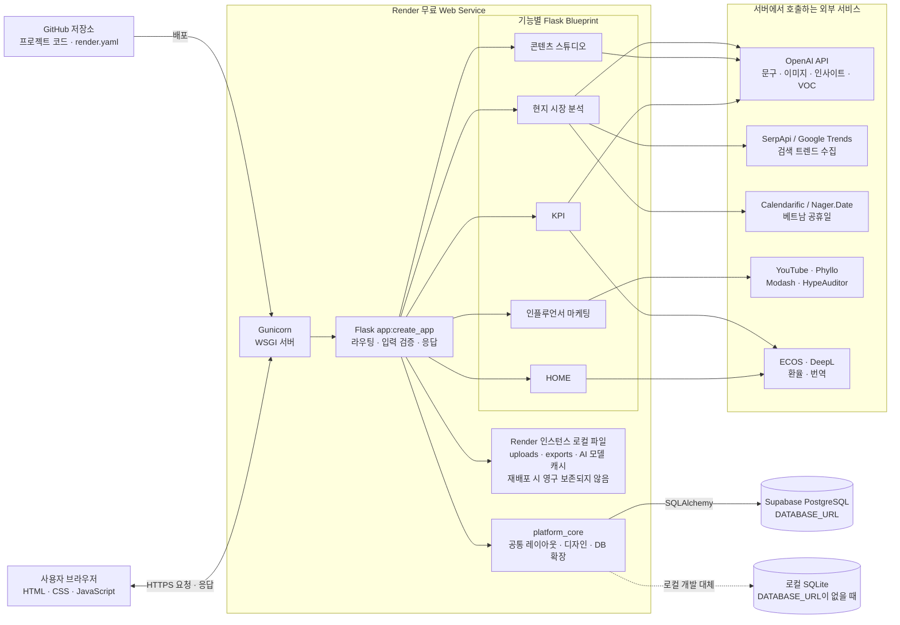

# README

# 한정선 베트남 마케팅 대시보드

> ‘한정선 찹쌀떡’의 베트남 현지화 진출을 담당하는 글로벌 마케터를 위한 Flask 기반 마케팅 지원 웹사이트입니다.
> 

베트남 시장의 트렌드와 마케팅 일정을 확인하고, 한정선 제품의 홍보 콘텐츠 제작·인플루언서 협업·예산 및 성과 관리를 한곳에서 진행하는 것을 목표로 합니다. **우선 진출 도시는 베트남 다낭**입니다.

**문서 상태: 개발 설계안.** 아래 구조와 기능은 앞으로 구현할 기준입니다. 현재 구현·API 연동·배포가 완료되었다는 의미가 아닙니다. 탭별 상세 설계는 각 폴더의 README에 있습니다(5장).

## 1. 프로젝트 목표와 사용자

### 핵심 페르소나

**‘한정선 찹쌀떡’의 베트남 현지화 진출을 담당하는 글로벌 마케터**

- 베트남 시장에서 어떤 타깃에게 어떤 메시지로 제품을 홍보할지 판단해야 합니다.
- 현지 연휴·기념일·과일 시즌에 맞춰 마케팅 일정을 준비합니다.
- 인스타그램 게시물·카드뉴스·포스터·숏폼 홍보영상을 제작합니다.
- 크리에이터·인플루언서 협업 일정과 오늘 할 일을 관리합니다.
- 제한된 마케팅 예산 안에서 광고비와 매출·고객 반응을 확인합니다.

### 기본 사용 흐름

1. **HOME**에서 오늘 할 일, 캠페인 준비 현황, 협업 진행 현황, 현지 일정과 뉴스를 확인합니다.
2. **현지 시장 분석**에서 트렌드·경쟁사·국가 문화를 살펴보고 AI 인사이트로 전략을 정합니다.
3. **콘텐츠 스튜디오**에서 포스터·카드뉴스·영상을 만들고 대화로 다듬습니다.
4. **인플루언서 마케팅**에서 협업 후보를 분류하고 제안 자료와 일정을 관리합니다.
5. **KPI**에서 성과와 예산을 확인합니다.

대시보드 화면은 **한국어만** 지원합니다.

## 2. 기술 선택: Flask + Blueprint

| 구분 | 선택 | 사용 목적 |
| --- | --- | --- |
| 서버 | Python 3.12, Flask | 페이지 요청, 데이터 처리, 외부 API 연결 |
| 모듈 분리 | Flask Blueprint | 기능별 URL·화면·정적 파일 분리 |
| 화면 | Jinja2, HTML, CSS, JavaScript | 대시보드 화면과 사용자 입력 처리 |
| 화면 갱신 | JavaScript Fetch | AI 요청·체크리스트·그래프 등 필요한 부분 갱신 |
| 그래프 | Chart.js (KPI 문서는 Plotly 제안 → 8장에서 하나로 확정) | KPI 그래프·예산 차트·HOME 진척 시각화 |
| 저장 | SQLAlchemy, 개발용 SQLite | 일정·체크리스트·협업·예산 등 변경 데이터 저장 |
| 언어 | 한국어 | 대시보드 화면 전체 |

라이브러리 추가가 필요하면 PM1(상준)에게 요청합니다. PDF·영상·이미지 생성 제공사는 요구 결과물을 확인한 뒤 해당 담당자가 제안합니다.

### 이 구조를 선택한 이유

- 각자 자기 기능의 Python·HTML·CSS·JavaScript를 한 폴더에서 관리할 수 있습니다.
- 외부 데이터 API와 AI 호출을 Python 서버에서 처리하기 편리합니다.
- 화면 서버와 API 서버를 나누지 않아 실행·통합 절차가 단순합니다.
- 공통 메뉴와 디자인은 유지하면서, 기능 내부는 독립적으로 개발할 수 있습니다.

근거: [Flask Blueprint 문서](https://flask.palletsprojects.com/en/stable/blueprints/)

**Flask를 쓴다는 사실만으로 Git 충돌이 없어지지는 않습니다.** 5장의 파일별 수정 권한과 10장의 Git 규칙까지 지키는 것이 핵심입니다.

### 2.1 시스템 아키텍처 다이어그램

| 구분 | 시스템 아키텍처 다이어그램 |
| --- | --- |
| 목적 | 서비스의 전체 구조와 요청·데이터 처리 흐름 파악 |
| 보여주는 대상 | 사용자 화면, Render 웹 서버, Flask Blueprint, 데이터베이스, 외부 API 연동 |
| 관점 | 런타임·인프라 구조를 중심으로 한 시스템 관점 |
| 핵심 질문 | “사용자의 요청이 어떤 구성요소를 거쳐 처리되고 어디에 저장되는가?” |

아래 다이어그램은 현재 저장소의 `app.py`, `render.yaml`, 각 Blueprint와 외부 API 호출 코드를 기준으로 작성했습니다. GitHub README에서 Mermaid 코드가 자동으로 다이어그램으로 표시되므로 별도 이미지 파일을 관리하지 않아도 됩니다.



#### 요청과 데이터 처리 흐름

1. 사용자가 브라우저에서 화면이나 기능을 요청합니다.
2. Render의 Gunicorn이 요청을 받아 Flask 앱 팩토리 `app:create_app`으로 전달합니다.
3. Flask가 URL에 맞는 기능별 Blueprint로 요청을 보냅니다.
4. 변경 데이터는 SQLAlchemy를 통해 운영 환경의 Supabase PostgreSQL에 저장됩니다. `DATABASE_URL`이 없는 로컬 환경에서는 SQLite를 사용합니다.
5. API 키가 필요한 작업은 브라우저가 아니라 Flask 서버에서 외부 서비스로 요청합니다.
6. 업로드·내보내기·AI 모델 캐시는 현재 Render 인스턴스의 로컬 경로를 사용하므로 영구 파일 보관 대상으로 간주하지 않습니다.

> 현재 코드에서 확인된 운영 DB 연결은 Supabase PostgreSQL입니다. Supabase Storage의 `uploads`·`results` 버킷은 생성되어 있어도 애플리케이션 업로드 코드와의 연결이 확인되기 전까지 아키텍처의 영구 저장소로 표시하지 않습니다.

## 3. 기능 범위

모든 항목의 현재 상태는 **설계 예정**입니다(콘텐츠 스튜디오·HOME 일부는 시연 화면이 있음). 세부 내용은 각 탭 README를 따릅니다.

| 메뉴 | 구현할 내용 | 담당 |
| --- | --- | --- |
| 공통 기반 | 공통 레이아웃·메뉴·디자인 토큰(6장), DB 초기화, 첫 접속 화면 경로 | PM1 (상준) |
| HOME | H01 오늘의 업무 요약·체크리스트, H02 통합 마케팅 캘린더, H03 역산 캠페인 생성 | 주연 |
| HOME | H04 캠페인 준비 현황·진척 시각화, H05 인플루언서 협업 진행 요약, H06 뉴스·트렌드 요약 | 주연 (원본: 상준·진혁) |
| HOME | H07 AI 오늘의 브리핑, H08 캠페인 템플릿·복제·회고(확장) | 주연 |
| 현지 시장 분석 | 국가 선택 바(베트남 기본) + 트렌드 분석(Google Trends) · 경쟁사 분석 · 국가·문화 · AI 인사이트 | 상준 |
| 콘텐츠 스튜디오 | **포스터**: AI 문구·이미지 + 요소(레이어)별 편집, Figma 연동 검증 | 희주 |
| 콘텐츠 스튜디오 | **카드뉴스**: 템플릿 + 기본 프롬프트(금기·차별 금지·한국다운 색), GPT/Canva | 희주 |
| 콘텐츠 스튜디오 | **배경 제거**(첨부 사진 편집 창, OpenCV), 광고 표현 검수 | 희주 |
| 콘텐츠 스튜디오 | **영상**: Higgsfield 프롬프트 초안 → 사용자 검토·승인 → 생성. 대화·이전 작업·되돌리기 등 탭 공통 기능 | 유진 |
| KPI | 상단 스코어카드(총 광고비 · 종합 ROAS · 누적 매출 · **실시간 VND/KRW 환율과 환차손익**) | 민지 |
| KPI | 예산 트래킹(도넛: 플랫폼 광고비 · 인플루언서 협찬비 · 잔여 예산), 채널별 ROAS 막대(Meta·TikTok·Shopee·인플루언서, 손익분기 300% 기준선) | 민지 |
| KPI | VOC 감성 분석(베트남어 리뷰 → 한국어 요약 · 긍정/중립/부정 · 키워드 Top 5), GA4 트래픽(켜고 끌 수 있는 모듈, 끄면 크리에이터별 전환표로 대체) | 민지 |
| 인플루언서 마케팅 | I01 리스트·지표 관리(규모 등급 · 조회수 중앙값 · 지표 기준일), I02 협업 제안 메일(베트남어·영어·한국어 + 광고 가이드라인 + 회신 양식) | 진혁 |
| 인플루언서 마케팅 | I03 회신 자동 정리(가능 여부 · 날짜 · 비용), I04 협업 일정 달력, I05 광고 단가 기록·비교(공개 참고가 · 견적 · 계약가) | 진혁 |
| 인플루언서 마케팅 | I06 CSV·PDF 반출 / CSV 가져오기, I07 요약 화면, I08 YouTube·Phyllo 연동, I09 HOME·KPI 공개 함수 | 진혁 |

인플루언서 마케팅은 **개인 브랜치에서 구현·시험을 마친 상태**입니다(아직 `premain` 머지 전, I08은 실제 키로 미확인).

HOME 마케팅 캘린더에는 **역산 캠페인** 기능을 넣습니다. 목표일을 정하면 준비 업무가 거꾸로 계산되어 체크리스트·캘린더·진척 현황에 함께 나타납니다.

### 구현 범위를 먼저 확정해야 하는 부분

- 인스타그램 자동화는 **게시물·카드뉴스 생성**까지로 설계합니다. 실제 계정 게시·예약은 별도로 결정합니다.
- 협업제안 자동화는 **메일과 가이드라인 초안 생성·복사**까지입니다. 실제 발송(Gmail API 등)은 확장 제안입니다. PDF는 브라우저 인쇄로 만듭니다.
- 광고 문구·표현 검수는 **참고 안내와 KOTRA 링크**를 기본으로 합니다. 법적 판단이 아닙니다.
- **광고비·예산 계산 공식은 민지가 제안안을 냈습니다(9장).** 팀이 확정하면 확정일을 기록합니다.
- **마켓셰어**는 현지 시장 분석 설계에서 “데이터를 구할 수 없어 제외”했습니다. HOME은 `자료 준비 중`으로 표시합니다(8장 확정 필요 목록).

회원가입, 결제, 주문, 물류, 통관, 커뮤니티, 수출·OEM은 현재 범위에 포함하지 않습니다.

## 4. 6인 역할 분담

**6명 모두 기능 하나를 맡고, 그중 상준(PM1)과 유진(PM2)이 PM을 겸합니다.** 콘텐츠 스튜디오는 2명이 나눠 맡습니다.

| 이름 | 역할 | 담당 기능 | 담당 폴더 |
| --- | --- | --- | --- |
| 주연 | 팀원 | HOME | `home/` |
| 상준 | **PM1** (코드 관리) | 현지 시장 분석 | `market_analysis/` + 공용 파일 |
| 유진 | **PM2** (진행·Git 관리) | 콘텐츠 스튜디오 (**영상** + 탭 공통) | `content_studio/` 중 유진 담당 파일 + `README.md` + `docs/` |
| 희주 | 팀원 | 콘텐츠 스튜디오 (**포스터·카드뉴스·배경 제거·검수**) | `content_studio/` 중 희주 담당 파일 |
| 민지 | 팀원 | KPI | `kpi/` |
| 진혁 | 팀원 | 인플루언서 마케팅 | `influencer_marketing/` |

### PM1 — 코드 관리 담당 (상준)

**“프로그램이 돌아가는 뼈대”를 책임집니다.** PM1(상준)도 위 표의 자기 기능을 함께 개발합니다.

- 공용 파일(`app.py`, `requirements.txt`, `.gitignore`, `.env.example`, `platform_core/`)을 **유일하게 수정**합니다.
- 개발 초기에 앱 생성·5개 메뉴 등록·공통 레이아웃·**디자인 토큰(6장)**·DB 초기화를 먼저 만들어 `premain`에 올립니다.
- 팀원의 공용 파일 수정 요청(라이브러리 추가, 메뉴 추가, 환경변수 추가 등)을 받아 반영하고 팀에 알립니다.
- `premain`에서 전체 앱이 실제로 실행되는지 확인합니다.
- `premain` → `main` PR을 **최종 머지**합니다.
- PM2가 올린 PR을 검토·머지합니다.

### PM2 — 진행·Git 관리 담당 (유진)

**“팀 작업이 순서대로 잘 합쳐지는 흐름”을 책임집니다.** PM2도 위 표의 자기 기능을 함께 개발합니다.

- 팀원이 `premain`으로 올린 PR을 **검토·머지**합니다. (Files changed에서 담당 구역 밖 수정이 없는지 확인)
- 머지 순서를 정합니다. (올라온 순서대로, 단 다른 작업의 기반이 되는 작업은 먼저)
- 충돌이 생기면 관련 팀원과 해결 과정을 조율하고 결과를 팀에 공유합니다.
- 전체 `README.md`와 `docs/`를 관리합니다. 각 탭 README를 받아 **5장 폴더 구조·3장 기능 범위·8장 연결 형식**에 반영합니다.
- 기능 간 연결 형식(`public.py`)이 정해졌는지 확인하고 진행 상황을 체크합니다.
- `premain` → `main` PR을 **작성**합니다.
- PM1(상준)이 올린 PR을 검토·머지합니다.

### PM끼리의 규칙

| 상황 | 누가 하나요? |
| --- | --- |
| 팀원 PR → `premain` 머지 | PM2 유진 (부재 시 PM1 상준) |
| PM1(상준)의 PR → `premain` 머지 | PM2 유진 |
| PM2(유진)의 PR → `premain` 머지 | PM1 상준 |
| `premain` → `main` | PM2 유진이 PR 작성 → PM1 상준이 실행 확인 후 머지 |
| 공용 코드 파일 수정 | PM1 상준만 |
| 전체 README·`docs/` 수정 | PM2 유진만 |
| 탭 README 수정 | 그 탭 담당자 (전체 README 반영은 PM2) |

PM의 기능 개발도 다른 팀원과 똑같이 개인 브랜치 → `premain` PR로 올립니다.

### 이름·브랜치 등록

개발 시작 전 아래 표를 채웁니다. 담당이 바뀌면 PM2가 이 표를 먼저 수정합니다.

| 이름 | 담당 기능 | PM | 개인 브랜치 |
| --- | --- | --- | --- |
| 주연 | HOME |  |  |
| 상준 | 현지 시장 분석 | PM1 |  |
| 유진 | 콘텐츠 스튜디오 (영상·공통) | PM2 |  |
| 희주 | 콘텐츠 스튜디오 (포스터·카드뉴스) |  |  |
| 민지 | KPI |  |  |
| 진혁 | 인플루언서 마케팅 |  |  |

## 5. 폴더 구조와 파일별 수정 권한

### 전체 폴더 구조

```
hanjeongseon_dashboard/
├── app.py                         # 앱 생성·설정·메뉴 등록·DB 초기화 명령    [PM1 상준]
├── README.md                      # 전체 안내 (이 문서)                     [PM2 유진]
├── requirements.txt               # 라이브러리 목록                        [PM1 상준]
├── .env.example                   # API 키 이름 예시 (실제 값 X)           [PM1 상준]
├── .gitignore                     # Git 제외 파일 설정                     [PM1 상준]
├── docs/                          # 공통 문서                             [PM2 유진]
│   └── design/                    # 디자인 규격 참고 시안 (6장)
│       ├── hanjungsun-vietnam-dashboard.html
│       └── hanjungsun-design.css
├── platform_core/                 # 공통 기반                             [PM1 상준]
│   ├── __init__.py
│   ├── extensions.py              # DB 객체
│   ├── templates/platform_core/
│   │   └── base.html              # 사이드바·상단바·공통 레이아웃
│   └── static/
│       ├── css/base.css           # 디자인 토큰(:root 변수)·공통 컴포넌트
│       └── fonts/                 # (필요 시) 직접 올리는 글꼴 파일
├── home/                          # HOME                                [주연]
├── market_analysis/               # 현지 시장 분석                        [상준]
├── content_studio/                # 콘텐츠 스튜디오                       [유진·희주]
├── kpi/                           # KPI                                 [민지]
└── influencer_marketing/          # 인플루언서 마케팅                     [진혁]
```

- `platform_core/extensions.py`는 DB 객체를 따로 두는 파일입니다. `app.py`에 넣으면 기능 폴더가 `app.py`를 import해야 해서 순환 참조가 생기므로 분리합니다.
- `instance/` 폴더는 **미리 만들지 않습니다.** 앱을 실행하면 자동으로 생기며 로컬 DB(`dashboard.sqlite3`), 업로드 사진(`uploads/<모듈명>/`), 생성 결과물(`exports/<모듈명>/`)이 저장됩니다. Git에 올리지 않습니다.
- 디자인 참고 이미지(공식 홈페이지 캡처·패키징 시안·폰트 견본, 약 17MB)는 용량이 커서 Git에 올리지 않고 팀 공유 드라이브에 둡니다. Git에는 시안 HTML·CSS만 둡니다.

### 탭 README 위치

| 탭 | 문서 | 담당 |
| --- | --- | --- |
| HOME | `home/README.md` | 주연 |
| 현지 시장 분석 | `market_analysis/README.md` (받은 파일 `market_analysis.md`) | 상준 |
| 콘텐츠 스튜디오 | `content_studio/README.md` | 유진·희주 (파일 주인은 유진, 희주 부분은 희주가 작성해 전달) |
| KPI | `kpi/README.md` (받은 파일 `KPI.md`) | 민지 |
| 인플루언서 마케팅 | `influencer_marketing/README.md` (받은 파일명 `README-INFLUENCER.md` → 이름 통일 제안) | 진혁 |
- 탭 README 파일명은 모두 `README.md`로 통일합니다. 파일명 규칙(영어 소문자)의 **문서 예외**입니다.
- 탭 README와 이 문서가 다르면 **탭 README가 세부 기준**입니다. 이 문서는 폴더·권한·연결·디자인 같은 팀 공통 기준을 정합니다.

### 각 기능 폴더의 내부 구조

#### HOME (`home/`, 주연)

```
home/
├── README.md                     # HOME 기능 명세
├── __init__.py                   # Blueprint 선언 (bp)
├── routes.py                     # 화면·입력 검증·읽기 연동·업무·캠페인 로직
├── models.py                     # home_campaigns · home_tasks · home_schedules · home_campaign_collaboration_links
├── templates/home/home_index.html
└── static/
    ├── css/home_main.css
    └── js/home_main.js
```

- HOME은 `public.py`를 두지 않습니다. 다른 탭 데이터는 ID만 저장하고 `public.py`로 읽습니다.
- 필요해지면 `home/` 안에서 템플릿·업무 로직 파일을 나눕니다.

#### 현지 시장 분석 (`market_analysis/`, 상준)

```
market_analysis/
├── README.md                     # 현지 시장 분석 설계
├── __init__.py                   # Blueprint (bp)
├── routes.py                     # 화면 · API · 시연 데이터 · AI 인사이트 호출
├── countries.py                  # 국가 등록부 + 현지어 검색어 대응표 (국가 추가 = 한 줄 추가)
├── public.py                     # get_events, get_news_summary (다른 탭 공개)
├── models.py                     # market_analysis_trend_* · competitor · country · culture · event · insight
├── templates/market_analysis/market_analysis_index.html
└── static/
    ├── css/market_analysis_main.css
    └── js/market_analysis_main.js
```

- 화면은 탭 4개(트렌드 분석 · 경쟁사 분석 · 국가·문화 · AI 인사이트)와 국가 선택 바로 구성합니다. URL 예: `/market_analysis/?country=VN&tab=trend`
- 껍데기 `public.py`(빈 리스트 반환)를 가장 먼저 머지합니다.

#### 콘텐츠 스튜디오 (`content_studio/`, 유진·희주)

한 폴더를 두 사람이 쓰므로 **파일 단위로 주인을 나눕니다.** 같은 파일을 둘이 고치지 않습니다.

```
content_studio/
├── README.md                      # 콘텐츠 스튜디오 설계                         [유진]
├── __init__.py                    # Blueprint 선언, routes import, 로컬 DB 칸 보정   [유진]
├── products.py                    # 제품 기본 정보 (+ 신메뉴 표시)                  [유진]
├── routes_sns.py                  # 화면, 대화·이전 작업·버전·첫 화면 API, 영상 API  [유진]
├── models_sns.py                  # 대화·메시지·디자인 버전 테이블                  [유진]
├── videos.py                      # 영상 프롬프트 초안 만들기·고치기                  [유진]
├── higgsfield.py                  # Higgsfield API 연동                            [유진]
├── designs.py                     # 포스터·카드뉴스 문서 만들기·고치기, 템플릿        [희주]
├── routes_media.py                # 사진 업로드, 배경 제거, 숏폼 콘티, 광고 표현 검수 [희주]
├── prompts/cardnews_base.md       # (예정) 카드뉴스 기본 프롬프트                    [희주]
├── templates/content_studio/
│   └── content_studio_index.html  # 세 탭(포스터·카드뉴스·영상) 공통 화면           [유진]
└── static/
    ├── css/sns.css                # 화면 전체 스타일                               [유진]
    ├── css/sns_image.css          # 사진 편집 창                                   [희주]
    ├── js/sns.js                  # 첫 화면·대화·이전 작업·되돌리기                 [유진]
    ├── js/sns_video.js            # 영상 초안·프롬프트 검토·결과                     [유진]
    ├── js/sns_editor.js           # 포스터·카드뉴스 편집기, 미리보기, PNG 내보내기     [희주]
    ├── js/sns_fonts.js            # 글꼴 목록 · 내 PC 글꼴                          [희주]
    ├── js/sns_image.js            # 사진 편집 창 (자르기·보정·배경 제거)              [희주]
    └── images/sns/                # 제품 자리표시 이미지                            [유진]
```

- URL은 `/content_studio/?tab=poster|cardnews|video` 하나이고, API는 `/content_studio/api/...`(유진), `/content_studio/media/api/...`(희주)로 나눕니다.
- 포스터·카드뉴스를 대화로 고치는 규칙은 `designs.py`(희주)에 두고, `routes_sns.py`(유진)는 부르기만 합니다.
- 공동 화면 파일(`content_studio_index.html`, `sns.css`, `sns.js`)을 바꿔야 하면 희주가 유진에게 요청합니다.

#### KPI (`kpi/`, 민지)

```
kpi/
├── README.md                     # KPI 기획·개발 명세
├── __init__.py                   # Blueprint 선언 (bp)
├── routes.py                     # 화면·API·환율 호출·ROAS/예산 계산·VOC 요약 호출·CSV 업로드
├── models.py                     # kpi_marketing_budget · kpi_ad_performance_daily · kpi_voc_reviews
├── templates/kpi/kpi_index.html  # 상단 스코어카드 / 중단 예산·ROAS / 하단 VOC·GA4(교체형) 3단 격자
└── static/
    ├── css/kpi_main.css
    └── js/kpi_main.js            # GA4 영역은 켜고 끌 수 있는 모듈 함수로 분리
```

- KPI 문서의 테이블 이름(`marketing_budget`, `ad_performance_daily`, `voc_reviews`)은 8장 규칙에 따라 `kpi_` 접두어를 붙입니다.
- 광고 성과·매출은 공식 API 대신 **마케터가 올리는 CSV**로 계산합니다(Meta·TikTok·Shopee 정산 자료).

#### 인플루언서 마케팅 (`influencer_marketing/`, 진혁)

```
influencer_marketing/
├── README.md                     # 인플루언서 마케팅 기능 문서
├── __init__.py                   # Blueprint 선언 (url_prefix="/influencer_marketing")
├── routes.py                     # 화면·API·CSV·보고서·회신 자동 정리·입력 검증·시연 데이터
├── models.py                     # influencer_marketing_influencers · _quotes · _settings
├── public.py                     # get_collaborations · get_today_tasks · get_quote_summary
├── external_api.py               # YouTube·Phyllo 호출, 오류 안내, 호출 기록
├── templates/influencer_marketing/
│   ├── influencer_index.html     # 메인 화면 (base.html 상속)
│   └── influencer_report.html    # 보고서 화면 (브라우저 인쇄 → PDF)
└── static/
    ├── css/influencer_main.css   # .influencer-page 안으로 제한
    └── js/influencer_main.js     # 전역 변수 없이 즉시 실행 함수
```

- 외부 API는 표준 라이브러리(`urllib`)만 써서 추가 라이브러리가 없습니다.
- 인플루언서 1명 = 협업 1건이며, `id`가 곧 `collaboration_id`입니다. 한 인플루언서와 여러 캠페인을 하게 되면 협업 테이블을 나눕니다(확장 제안).
- 처음에는 `routes.py` 하나에 로직을 모두 씁니다. 파일이 너무 길어지면 담당자가 **자기 폴더 안에서** 나눕니다.
- API 연결 전 예시 데이터는 `routes.py` 안에 넣고, 화면에 “시연 데이터”라고 표시합니다.

### 기능별로 만드는 파일

| 파일 | home주연 | market_analysis상준 | content_studio유진·희주 | kpi민지 | influencer_marketing진혁 | 언제 필요한가 |
| --- | --- | --- | --- | --- | --- | --- |
| `README.md` | ✅ | ✅ | ✅ | ✅ | ✅ | 항상 (탭 설계 문서) |
| `__init__.py`, `routes.py` | ✅ | ✅ | ✅ (routes 2개) | ✅ | ✅ | 항상 |
| `templates/`, `static/css`, `static/js` | ✅ | ✅ | ✅ | ✅ | ✅ | 항상 |
| `models.py` | ✅ | ✅ | ✅ (`models_sns.py`) | ✅ | ✅ | 저장할 데이터가 있을 때 |
| `public.py` | ❌ | ✅ | ❌ | ❌ | ✅ | 다른 기능에 데이터를 넘겨줄 때 |
| 기타 모듈 파일 | — | `countries.py` | `products.py`, `designs.py`, `videos.py`, `higgsfield.py` | — | `external_api.py` | 담당자가 자기 폴더 안에서 추가 |
| `static/images/` | 필요 시 | 필요 시 | ✅ | 필요 시 | 필요 시 | 고정 이미지를 쓸 때 |

### 파일별 수정 권한 — 한눈에 보기

> **원칙: 내 칸에 ✏️가 있는 파일만 고칩니다.** 👀는 읽거나 `import`해서 쓰는 것만 가능하고, 고치면 안 됩니다.
> 

**공용 파일**

| 파일·폴더 | PM1 (상준) | PM2 (유진) | 그 외 팀원 |
| --- | --- | --- | --- |
| `app.py` | ✏️ | ❌ | ❌ |
| `requirements.txt` | ✏️ | ❌ | ❌ |
| `.gitignore`, `.env.example` | ✏️ | ❌ | ❌ |
| `platform_core/` 전체 (디자인 토큰 포함) | ✏️ | 👀 | 👀 |
| `README.md`, `docs/` | ❌ | ✏️ | ❌ |

**기능 폴더**

| 파일·폴더 | 주연 | 상준 | 유진 | 희주 | 민지 | 진혁 |
| --- | --- | --- | --- | --- | --- | --- |
| `home/` | ✏️ | ❌ | ❌ | ❌ | ❌ | ❌ |
| `market_analysis/` (`public.py` 제외) | ❌ | ✏️ | ❌ | ❌ | ❌ | ❌ |
| `market_analysis/public.py` | 👀 | ✏️ | 👀 | 👀 | ❌ | 👀 |
| `content_studio/` 유진 담당 파일 | ❌ | ❌ | ✏️ | 👀 | ❌ | ❌ |
| `content_studio/` 희주 담당 파일 | ❌ | ❌ | 👀 | ✏️ | ❌ | ❌ |
| `kpi/` | ❌ | ❌ | ❌ | ❌ | ✏️ | ❌ |
| `influencer_marketing/` (`public.py` 제외) | ❌ | ❌ | ❌ | ❌ | ❌ | ✏️ |
| `influencer_marketing/public.py` | 👀 | ❌ | ❌ | ❌ | 👀 | ✏️ |
| `instance/`, `.env` | 각자 로컬에만 · Git에 올리지 않음 |  |  |  |  |  |

✏️ 수정 가능 · 👀 읽기/import만 가능 · ❌ 건드리지 않음

### 이럴 땐 이렇게

| 하고 싶은 일 | 직접 고치지 말고 |
| --- | --- |
| 라이브러리를 추가하고 싶다 | PM1(상준)에게 라이브러리 이름 전달 → PM1이 `requirements.txt` 수정 |
| API 키 이름을 추가하고 싶다 | PM1(상준)에게 변수 이름 전달 → PM1이 `.env.example` 수정, 실제 키는 각자 `.env`에 |
| 공통 메뉴·디자인 토큰·버튼을 바꾸고 싶다 | PM1(상준)에게 요청 → PM1이 `platform_core/` 수정 |
| 전체 README에 내용을 추가하고 싶다 | 자기 탭 README를 고친 뒤 PM2에게 알림 → PM2가 `README.md` 반영 |
| 다른 기능의 데이터가 필요하다 | 그 기능 담당자에게 요청 → 담당자가 자기 `public.py`에 함수 추가 |
| 콘텐츠 스튜디오 공동 파일을 바꾸고 싶다 | 희주 → 유진에게 요청 → 유진이 수정 |
| 다른 기능에 버그가 보인다 | 그 기능 담당자에게 알림 → 담당자가 자기 브랜치에서 수정 |

## 6. 디자인 규격

**모든 탭은 이 장의 색·글꼴·레이아웃을 따릅니다.** 기준 시안은 희주가 만든 데모 대시보드(`docs/design/hanjungsun-vietnam-dashboard.html`, `hanjungsun-design.css`)입니다. 공통 값은 PM1이 `platform_core/static/css/base.css`에 변수로 넣고, 각 탭은 그 변수만 씁니다.

### 6.1 브랜드 콘셉트·분위기

- **한 줄 콘셉트:** “A little Korea, in Vietnam.” — 한정선의 정성을 베트남의 일상으로.
- **분위기:** 따뜻한 크림 종이 바탕에 브라운·골드 포인트. 고급 선물 브랜드의 차분한 에디토리얼 느낌. 여백을 넉넉히 두고 장식은 줄입니다.
- **브랜드 요소:** 한자 로고 **韓貞仙** / 영문 **HANJUNGSUN**, 보자기·달(보름달)·한지 질감 같은 한국적 소재.
- **베트남 요소(패키징 시안):** 다낭 용다리·바나힐 손 다리·핑크 성당·등불, 열대과일(망고·두리안·코코넛·패션프루트) 일러스트. 6구·9구 박스 + 보자기, 개별 포장, 전단지·메뉴판, 보냉백, 다낭 매장·유니폼.
- **피할 것:** 원색 위주의 화려한 관리자 화면, 큰 그림자·둥근 말랑한 카드, 귀여운 캐릭터 일러스트(레퍼런스 중 파스텔·캐릭터 시안은 레이아웃만 참고).

### 6.2 레퍼런스

| 구분 | 자료 | 참고할 점 |
| --- | --- | --- |
| 공식 홈페이지 | [https://hanjungsun.co.kr/](https://hanjungsun.co.kr/) | 따뜻한 갈색 배경, 보름달 원형, 보자기 선물 연출, 흰색 한자 로고 |
| 브랜드 레퍼런스 | [https://www.warabimochi-kamakura.com/](https://www.warabimochi-kamakura.com/) | 떡 브랜드의 절제된 여백·사진 중심 구성 |
| 기준 시안 | `docs/design/hanjungsun-vietnam-dashboard.html` (희주) | 색·글꼴·사이드바·히어로·패널·배지 등 **실제 적용 기준** |
| 대시보드 레퍼런스 | 핀터레스트 2종 (공유 드라이브) | KPI 카드 줄, 오늘의 할 일, 캘린더, 빠른 실행 카드의 **배치만** 참고 |
| 베트남 진출 패키징 | 패키징 시안 3종 (공유 드라이브) | 콘텐츠 스튜디오 포스터·카드뉴스 일러스트 톤 |

### 6.3 색

| 변수 | 값 | 용도 |
| --- | --- | --- |
| `--paper` | `#f7f5ef` | 페이지 배경 (크림 종이) |
| `--white` | `#fffefa` | 패널·입력칸 배경 |
| `--ink` | `#302e27` | 기본 글자 |
| `--muted` | `#827e73` | 보조 글자·설명 |
| `--line` | `#e6e1d6` | 테두리·구분선 |
| `--gold` | `#a18143` | 강조 포인트·캠페인 표시·진척 막대 |
| `--green` | `#52654c` | 긍정·진행·증가 |
| `--brown` | `#40382b` | 진한 버튼(`.btn.dark`)·토스트 |
| 사이드바 | `#efede5` / 선택 `#ded7c6` | 왼쪽 메뉴 배경 / 현재 메뉴 |
| 배지 기본 | `#ece8dc` · 글자 `#736446` | 상태 표시 |
| 배지 긍정 | `#e7ece2` · 글자 `#52654c` | 완료·진행 |
| 배지 주의 | `#f4e6df` · 글자 `#9a5b41` | 우선·지연·주의 |
| 히어로 | `#493b28` → `#8d7651` 그라데이션 + 사진 | 첫 화면 큰 배너 |
| 시연 표시 | `#eae3d4` · 글자 `#78613d` | “DEMO · 예시 데이터” |
- **대시보드 화면 색**과 **콘텐츠(포스터·카드뉴스) 색**은 구분합니다. 콘텐츠 색은 제품 색과 현지 문화 기준을 따릅니다. 문화 기준은 현지 시장 분석의 “국가·문화”입니다. 예: 빨강·금색은 권장하고, 흰색·검정 위주는 주의합니다.
- 상태를 색만으로 구분하지 않고 글자(예: “지연”, “완료”)를 함께 씁니다.

### 6.4 글꼴

| 용도 | 지금 시안 | 후보 (폰트 레퍼런스) | 비고 |
| --- | --- | --- | --- |
| 본문·UI | Pretendard → Noto Sans KR → 맑은 고딕 | 부크크 고딕 · 눈누 기초고딕 · IBM Plex Sans KR (200~600) | 13px / 줄간격 1.6 |
| 제목 | 본문 글꼴 500~600 | **하다 산스** (Hada Type, 9가지 굵기) | 페이지 제목·패널 제목 |
| 브랜드·숫자 강조 | Georgia · 바탕 (세리프) | — | 韓貞仙 로고, KPI 숫자, 히어로 문구 |
| 베트남어 | (지정 없음) | Roboto · Google Sans · Raleway (산세리프) / Playfair Display · Merriweather (세리프) | 성조 표기 확인 필수 |

| 요소 | 크기·굵기 |
| --- | --- |
| 페이지 제목 (`h1`) | 27px · 500 · 자간 -1.2px |
| 패널 제목 | 14px · 600 |
| 영문 소제목 (eyebrow) | 9px · 600 · 자간 2px · 대문자 (예: `PLAN THE NEXT STEP`) |
| KPI 숫자 | 세리프 30px |
| 본문 / 보조 | 13px / 10~11px |
- 한글 전용 글꼴은 일부 베트남어 성조 글자를 다른 글꼴로 바꿔 보여줄 수 있습니다. 베트남어 문장에는 베트남어 후보 글꼴을 지정합니다.
- 글꼴은 **상업적 사용 라이선스를 확인**한 뒤 확정합니다. Roboto·Playfair Display·Raleway·Merriweather·IBM Plex는 오픈 라이선스이고, 눈누 글꼴·하다 산스·부크크 고딕·Google Sans는 각 배포처 조건을 확인합니다.
- 웹글꼴은 Google Fonts로 불러오거나 `platform_core/static/fonts/`에 두고 PM1이 연결합니다.
- 시안의 9px 글자는 작아서 읽기 어렵습니다. 실제 화면은 **최소 11px**을 권장합니다.

### 6.5 레이아웃·컴포넌트

| 요소 | 규격 |
| --- | --- |
| 사이드바 | 왼쪽 고정 218px. 위: 韓貞仙 로고 → 작업 공간 선택(Vietnam Market) → 메뉴 01~05(선 아이콘 + 번호). 아래: 브랜드 문구 · 팀 이름 |
| 상단바 | 높이 69px. 왼쪽 경로(Workspace / 현재 메뉴), 오른쪽 문구 + `DEMO · 예시 데이터` 배지 |
| 본문 | 최대 1600px, 여백 30px / 36px |
| 페이지 머리 | 영문 소제목 + 한국어 제목 + 한 줄 설명, 오른쪽에 기준일·PDF/인쇄 버튼 |
| 히어로 | 사진 + 어두운 갈색 그라데이션 + 세리프 카피 (HOME 첫 화면) |
| KPI 줄 | 4칸, 칸 사이 1px 선 |
| 본문 격자 | 1.5 : 1 두 칸 (1100px 이하에서 한 칸) |
| 패널 | `--white` 바탕, 1px `--line` 테두리, 모서리 2~3px, **그림자 없음** |
| 버튼 | 기본: 흰 바탕 + 선, 강조: `.btn.dark`(브라운) |
| 배지 | 9~11px, 모서리 2px, 6.3의 배지 색 |
| 표 | 머리 칸 `--paper` 바탕, 줄 구분선만 |
| 아이콘 | 선 아이콘(stroke 1.5), 채운 아이콘·이모지 아이콘은 쓰지 않음 |
| 시연 안내 | `.empty-note` 띠(크림 바탕)로 화면 위에 표시 |
| 반응형 | 1500px 이상 확대 · 1100px 이하 한 칸 · 650px 이하 사이드바가 위쪽 가로 메뉴로 |
| 인쇄 | 사이드바·버튼을 숨기고 패널이 페이지에서 잘리지 않게 |

### 6.6 문구 톤

- 짧고 정중하게 씁니다. 과장·최상급 표현은 쓰지 않습니다.
- 패널 제목은 **영문 소제목 + 한국어 제목** 짝으로 씁니다. 예: `FOCUS FOR TODAY` / 오늘의 할 일
- 시연 데이터는 항상 `DEMO · 예시 데이터` 또는 “시연”으로 표시합니다.

### 6.7 적용 순서

1. PM1이 6.3·6.4 값을 `platform_core/static/css/base.css`의 `:root` 변수와 공통 컴포넌트(`.panel`, `.btn`, `.badge`, `.eyebrow`, `.empty-note` 등)로 만듭니다.
2. PM1이 `base.html`을 시안의 사이드바·상단바 구조로 바꿉니다.
3. 각 담당자가 자기 탭 CSS에서 색·글꼴을 직접 쓰지 않고 변수로 바꿉니다. 지금의 HOME·콘텐츠 스튜디오 시연 화면은 주황 계열이라 이때 함께 바뀝니다.
4. PM2가 탭별 화면을 확인하고 어긋난 곳을 담당자에게 알립니다.

### 6.8 디자인에서 확정할 것

- [ ]  메뉴 이름: 시안의 `홈 대시보드 · 마케팅 스튜디오 · 현지 인사이트 · 성과 & 예산 · 인플루언서`와 모듈 이름(HOME · 콘텐츠 스튜디오 · 현지 시장 분석 · KPI · 인플루언서 마케팅) 중 무엇을 쓸지
- [ ]  본문·제목·베트남어 글꼴 최종 선택과 라이선스 확인
- [ ]  히어로 사진: 공식 홈페이지 이미지 사용 허락, 또는 자체 촬영 사진
- [ ]  첫 접속 화면(소개 화면) 디자인과 담당 (7장)

## 7. Flask 연결 규칙

### URL과 Blueprint 이름

| 모듈 | Blueprint 이름 | 화면 URL | 담당 |
| --- | --- | --- | --- |
| HOME | `home` | `/home/` | 주연 |
| 현지 시장 분석 | `market_analysis` | `/market_analysis/` (`?country=VN&tab=trend`) | 상준 |
| 콘텐츠 스튜디오 | `content_studio` | `/content_studio/` (`?tab=poster\|cardnews\|video`) | 유진·희주 |
| KPI | `kpi` | `/kpi/` | 민지 |
| 인플루언서 마케팅 | `influencer_marketing` | `/influencer_marketing/` | 진혁 |

지금은 루트 `/`를 `/home/`으로 연결합니다. HOME 설계에 따라 **첫 접속 화면**을 두고 `[대시보드 바로가기]`로 `/home/`에 들어가는 방식으로 바꿀 예정입니다. 경로와 담당은 PM1·PM2가 확정합니다.

각 담당자는 자기 URL 아래에서만 페이지와 API를 추가합니다. 예: `/home/api/tasks`, `/content_studio/api/messages`.

각 모듈은 `__init__.py`에서 `bp`를 만들고, PM1(상준)이 `app.py`에서 등록합니다. 모듈은 `app.py`를 `import`하지 않습니다. DB 객체는 `platform_core/extensions.py`에서 가져옵니다.

### 템플릿과 디자인 이름 충돌 방지

- 화면 경로: `templates/kpi/kpi_index.html` → `render_template("kpi/kpi_index.html")`
- 공통 레이아웃 사용: ``
- 정적 파일 참조: `url_for("kpi.static", filename="css/kpi_main.css")`
- CSS 선택자는 `.kpi-page`처럼 기능별 최상위 영역 아래로 제한합니다. 콘텐츠 스튜디오는 `.studio-chat`, `.studio-tabs`, `.img-editor`를 씁니다.
- 기능 CSS에서 `body`, `button`, `table` 전체 스타일을 바꾸지 않습니다. 색·글꼴은 6장 변수만 씁니다.
- JavaScript는 각 화면에서만 불러오고 전역 변수·함수 이름을 공유하지 않습니다. (ES 모듈 권장)

### 요청 처리 흐름

```
HTML / JavaScript
        ↓
routes.py      요청 읽기·입력 검증·기능 로직·외부 API 호출·응답 반환
        ↓
models.py      자기 기능의 DB 테이블 (있는 기능만)
```

AI·이미지·영상 생성 키는 서버에서만 사용합니다. 영상처럼 오래 걸리는 작업은 제공사의 작업 ID와 상태를 저장하고 화면에서 상태를 조회하는 흐름으로 설계합니다.

### 시간대

- HOME 업무 판정·마감 기준은 **한국 시간(`Asia/Seoul`)**입니다. 사이드바에 **베트남 시간(`Asia/Ho_Chi_Minh`)**을 보조로 표시합니다.
- 인플루언서 협업 일정은 현지 상대와 맞추는 일정이라 **베트남 시간(UTC+7)** 기준으로 안내합니다(한국이 2시간 빠름). HOME에 표시할 때 어느 시간대로 보여줄지 함께 정합니다.
- 시각 데이터는 UTC로 저장하고 화면에서 변환하는 안을 PM1과 확정합니다.

## 8. 데이터 소유권과 기능 연결

> **핵심: “두 탭이 같은 데이터를 함께 고치는 구조”가 아니라, “한 탭이 주인이고 다른 탭은 그 데이터의 ID만 들고 다니는 구조”로 만듭니다.** 그러면 Git 충돌도, DB 꼬임도 생기지 않습니다.
> 

### 연동 원칙

- 각 데이터는 **주인 탭 하나만** 저장·수정·삭제합니다.
- 다른 탭은 그 데이터의 **ID만 들고 다니고**, 내용은 주인의 **`public.py` 함수로 읽어서 표시만** 합니다. 남의 테이블을 직접 조회하거나 내 테이블에 복사해 저장하지 않습니다.
- 다른 탭 데이터가 내 화면에 뜨는 것도 **읽기 연동**입니다. 열 때마다 원본을 읽으므로 주인이 수정하면 자동 반영되고, 따로 동기화하지 않습니다.
- 다른 탭으로 가는 것은 **링크 이동**입니다. 예: HOME 캘린더의 인플루언서 일정 → `/influencer_marketing/?collaboration_id=...`
- 내 화면에서 남의 데이터를 꼭 바꿔야 하면, 주인이 `public.py`에 수정 함수를 만들어 공개하고 나는 그 함수를 호출합니다.
- 요약·가공은 **주인이 한 번만** 하고 결과를 공개합니다. 예: 뉴스 요약은 상준이 해서 저장해 둡니다. HOME의 AI 브리핑은 이 요약을 다시 요약하지 않습니다.

### 공통 키 규칙

- 숫자 자동번호 대신 **문자열 ID**를 씁니다. 예: `vn_teachers_day_2026` (형식: `{국가코드}_{이름}_{연도}`)
- ID는 **주인만 만들고**, 한 번 정하면 바꾸지 않습니다.
- 다른 탭 ID는 DB 외래키 없이 **문자열 칸으로 저장**합니다.
- 원본을 정상 조회했는데 ID가 없으면 “삭제됨”, 원본 조회 자체가 실패하면 “정보를 불러오지 못함”으로 구분해 표시합니다.

| 다른 탭에 보여줄 것 | 원본 주인 | 공개 함수 (안) | 들고 다니는 ID | 쓰는 탭 |
| --- | --- | --- | --- | --- |
| 기념일·공휴일·과일 시즌 | 상준 | `get_events(country="VN", year=None)` → `event_id, country, name, date, type(holiday·anniversary·fruit_season)` | `event_id` | HOME, 콘텐츠 스튜디오 |
| 뉴스 요약 | 상준 | `get_news_summary(country="VN", limit=5)` → `news_id, country, title, summary, source, published_at` | `news_id` | HOME |
| 인플루언서 협업 | 진혁 | `get_collaborations(event_id=None, include_demo=True)` → `collaboration_id, event_id, influencer, main_platform, followers, status, status_label, available_shoot_dates, shoot_date, post_date, is_demo, link` | `collaboration_id`, `event_id` | HOME |
| 인플루언서 할 일 | 진혁 | `get_today_tasks(limit=10, include_demo=True)` → `task_id, kind, collaboration_id, influencer, title, detail, due_date, is_demo, link` | `task_id` | HOME |
| 인플루언서 단가 | 진혁 | `get_quote_summary(include_demo=True)` → `quote_id, collaboration_id, influencer, platform, content_format, price_type(public·quote·contract), amount, currency, amount_usd, amount_vnd, quoted_on, followers, expected_views, actual_views, is_demo` | `quote_id` | KPI |
- 협업 `status` 값: `candidate, sent, replied, negotiating, confirmed, shot, posted, declined` (완료 = `posted`, 불가·보류 = `declined`)
- 할 일 `kind` 값: `review`(회신 확인), `late`(회신 지연 7일), `pick`(촬영일 확정), `soon`(촬영 임박 14일), `stale`(지표 45일 경과)
- 진혁의 공개 함수는 **구현·시험 완료**입니다. 오류가 나면 빈 목록 `[]`, 값이 없으면 `""` 또는 `None`을 돌려줍니다.

### 원본은 한 곳에서 관리합니다

| 데이터 | 원본 담당 | 사용하는 화면 |
| --- | --- | --- |
| 트렌드·경쟁사·국가·문화·AI 인사이트 | 현지 시장 분석 (상준) | 현지 시장 분석 |
| 뉴스 요약 | 현지 시장 분석 (상준) | 현지 시장 분석, HOME |
| 베트남 연휴·기념일·과일 시즌 | 현지 시장 분석 (상준) | HOME 캘린더·캠페인, 콘텐츠 스튜디오 추천 |
| 캠페인·업무·직접 등록 일정·캠페인-협업 연결 | HOME (주연) | HOME |
| 인플루언서 후보·채널 지표·연락처·협업 상태·회신·일정 | 인플루언서 마케팅 (진혁) | 인플루언서 마케팅, HOME |
| 광고 단가(공개 참고가·견적·계약가) 원자료 | 인플루언서 마케팅 (진혁) | 인플루언서 마케팅, KPI |
| GA·VOC·광고비·매출·예산·환율 환산·예산 공식 | KPI (민지) | KPI |
| 콘텐츠 대화·영상 작업 | 콘텐츠 스튜디오 (유진) | 콘텐츠 스튜디오 |
| 포스터·카드뉴스 디자인 문서·배경 제거 결과 | 콘텐츠 스튜디오 (희주) | 콘텐츠 스튜디오 |

HOME은 현지 시장 분석과 인플루언서 마케팅 정보를 읽어 표시만 합니다. 같은 데이터를 HOME DB에 복사해 따로 관리하지 않습니다.

### 허용하는 연결 방향

```
HOME (주연) ──────────────→ market_analysis/public.py      (상준)
   └──────────────────────→ influencer_marketing/public.py (진혁)
콘텐츠 스튜디오 (유진·희주) ─→ market_analysis/public.py      (상준)
KPI (민지) ───────────────→ influencer_marketing/public.py (진혁)
인플루언서 마케팅 (진혁) ───→ market_analysis/public.py      (상준)
모든 기능 ────────────────→ platform_core/ 의 DB 객체 (PM1 상준)
```

- 다른 기능은 `public.py`로만 사용합니다. 다른 기능의 `models.py`, `routes.py`를 직접 `import`하지 않습니다.
- `market_analysis/`는 다른 기능을 `import`하지 않습니다. `influencer_marketing/`은 `market_analysis/public.py`만 `import`할 수 있습니다(순환 참조 금지).
- HOME → KPI 읽기 연동은 지금 허용된 연결이 아닙니다. 채택하면 이 그림을 먼저 고칩니다.

### 연결 전 합의할 형식

개발 초기에 아래를 정하고, PM2가 이 장에 기록합니다.

- [ ]  `get_events()`: 단일 `date`를 유지할지, 기간(`start_date`·`end_date`)·지역·출처·`is_demo` 필드를 추가할지 (상준·주연·유진·희주)
- [ ]  과일 시즌을 `get_events()`의 `type=fruit_season`으로 줄지, 별도 함수로 줄지 (상준·유진·희주)
- [ ]  `get_news_summary()`의 지역 범위·주제·출처 링크 필드 (상준·주연)
- [ ]  `get_collaborations()`에 HOME이 요청한 필드 추가 여부: `updated_at`, `milestones: [{type, date, done}]`(negotiation·shoot_available·shoot_confirmed·post), `next_action`·`requires_attention` (진혁·주연)
- [ ]  개별 협업 이동 주소: `/influencer_marketing/?collaboration_id=...`로 편집 창 바로 열기 추가 (진혁·주연)
- [ ]  **환율 원본**: KPI는 실시간 환율(100 VND당 KRW), 인플루언서는 저장한 USD 기준 환율을 씁니다. KPI가 `amount`·`currency`로 직접 환산하는 안 (민지·진혁)
- [ ]  **예상·실제 지출 기준**: KPI의 “인플루언서 예상 지출액”은 `price_type=quote`, “실제 지출”은 `price_type=contract` 금액을 쓰는 안 (민지·진혁)
- [ ]  차트 라이브러리: Chart.js(이 문서) vs Plotly(KPI 문서) 하나로 통일 (민지·PM1)
- [ ]  AI 제공사: HOME 브리핑(미정)·콘텐츠 스튜디오(GPT 검토)·KPI VOC(Gemini 무료 티어) — 하나로 통일할지, 탭별로 둘지와 비용 (전원·PM1)
- [ ]  `.env` 읽는 방식(python-dotenv 사용 여부) (PM1)
- [ ]  `public.py` 우선 머지 순서: 진혁의 `influencer_marketing/public.py`가 이미 구현돼 있으므로 HOME·KPI 연결 전에 먼저 머지 (PM2)
- [ ]  마켓셰어: 현지 시장 분석은 “데이터 없음으로 제외”, HOME은 “자료 준비 중 표시”로 정리할지 (상준·주연)
- [ ]  탭 간 링크 주소 형식 (주인 + 링크를 거는 사람)

`public.py` 담당자(상준, 진혁)가 함수 설명(docstring)에 반환 필드·타입·빈 값 처리·예시를 적고, 사용하는 담당자가 확인한 뒤 연결합니다. 형식을 바꿀 때는 사용하는 담당자에게 먼저 알리고, 필드는 지우지 말고 추가만 합니다.

### DB 충돌 방지

- 테이블 이름은 `home_`, `market_analysis_`, `content_studio_sns_`, `content_studio_media_`, `kpi_`, `influencer_marketing_` 접두어로 구분합니다.
- 테이블 읽기·쓰기는 원본 담당 모듈만 합니다.
- 테이블을 바꾸면 PR 본문에 적고, 각자 로컬 DB를 지운 뒤 다시 초기화합니다.

## 9. 데이터 출처와 기준

| 영역 | 데이터 확보 방식 | 주기 | 확인할 내용 |
| --- | --- | --- | --- |
| 검색 관심도·급상승·지역·계절성 | Google Trends (CSV → 공식 API 전환) | 월 1회 | “검색량”이 아닌 관심도(0~100), 비교 검색어 5개 이하, 현지어 검색어 |
| 경쟁 제품 | Shopee·Lazada·TikTok Shop 수동 조사 CSV + 매장 조사 | 월 1회 | 크롤링 이용약관, 판매량은 추정치 |
| 뉴스 | Google 뉴스 RSS(베트남어) 검토 | 수시 | NewsAPI는 베트남어 미지원 |
| 국가 기본 정보 | REST Countries / World Bank (검토) | 분기 1회 | 기준일 |
| 문화·패키징·기후 | 출처 있는 참고 자료 (KOTRA 등) | 수시 | 출처·검토일 기록 |
| 베트남 연휴·기념일·과일 시즌 | 공휴일 API(검토) + 수동 | 연 1회 | 대상 연도·지역·출처, 확정·추정 구분 |
| GA4 | GA4 Data API 또는 `mock_ga4.json` (켜고 끌 수 있는 모듈) | — | 속성·조회 권한. 어려우면 크리에이터별 전환표로 대체 |
| VOC | 사전 수집한 베트남어 리뷰 CSV(Shopee·Instagram·TikTok) + Gemini API 요약·감성 분류 | — | 실제 자료 제공 여부, 번역 검수 |
| 광고비·매출 | Meta·TikTok·Shopee 정산용 CSV 업로드 (공식 API 대신) | 일별 | 통화(VND)·집계 기간·실제/예상 구분 |
| 예산 | 내부 DB 또는 CSV/Google Sheets | 월별 | 총 배정 예산(KRW)·편성 시점 기준 환율 |
| 환율 | open.er-api.com (키 없이 호출, VND→KRW) | 실시간 | 기준: 100 VND당 KRW |
| 인플루언서 지표 | 직접 입력(기본) · YouTube Data API(하루 10,000 유닛) · Phyllo · TikTok One 화면 · 에이전시 자료 | 45일마다 갱신 | 지표 기준일·출처, 조회수는 평균이 아닌 **중앙값**. 크롤링은 하지 않음 |
| 광고 단가 참고가 | Best Martech 2026 공개 참고가(게시물 1건, USD) + 받은 견적·계약가 | 수시 | 공개 참고가는 실제 계약가가 아님 |
| AI·미디어 생성 | 선정할 제공사의 API (GPT, Higgsfield 등) | 생성 시 | 입력 조건·결과 형태·비용·실행 시간 |
| 광고 표현 참고 | 관련 KOTRA 자료 링크 | — | 문구와 실제 관련된 자료인지 확인 |

특정 API가 해당 데이터를 제공한다고 미리 가정하지 않습니다. 마켓셰어·채널별 판매 비중·SNS 언급량은 데이터를 구할 수 없어 제외합니다.

### 광고비·예산 계산 공식 (민지 제안 · 확정 전)

> 민지가 KPI 문서에서 제안한 공식입니다. 팀 회의에서 확정하면 확정일을 적습니다. 인플루언서 탭의 단가 계산(조회 1천 회당 비용 등)은 참고용이며, KPI 공식이 확정되면 맞춥니다.
> 

| 항목 | 공식 (안) | 확정일 |
| --- | --- | --- |
| 예산 소진율(%) | (플랫폼 광고 집행비 + 인플루언서 협찬 집행비) ÷ 총 배정 마케팅 예산 × 100 |  |
| 잔여 가용 예산 | 총 배정 마케팅 예산 − (실제 지출 확정액 + 인플루언서 예상 지출액) |  |
| ROAS(%) | 해당 광고 캠페인으로 발생한 매출액 ÷ 투입 광고비 × 100 (손익분기 기준선 300%) |  |
| CPA(전환당 비용) | 투입 광고비 ÷ 구매 전환 건수 |  |
| 원화 환산 매출(KRW) | 현지 매출액(VND) × 실시간 환율(100 VND당 KRW) ÷ 100 |  |
| 환차손익 | 예산 편성 시점 기준 환율(예: 100 VND = 5.40 KRW) 대비 실제 결제 시점 환율 차이로 계산 |  |
| (참고) 조회 1천 회당 비용 | 금액 ÷ 해당 채널 조회수 중앙값 × 1,000 — 인플루언서 탭 참고값 |  |

### 공통 기준

- 날짜는 `YYYY-MM-DD`, 시간이 필요한 일정은 시간대를 함께 관리합니다.
- 출처·기준일을 유지하고, 실제 데이터와 시연 데이터를 화면에서 구분합니다.
- 지역 범위(다낭·베트남 전국)를 구분합니다. 전국 자료를 다낭 전용 데이터처럼 설명하지 않습니다.
- 금액은 원래 통화(VND·USD·KRW)와 함께 저장하고, 환산은 KPI 공식으로 합니다.

### 환경변수 모음 (`.env`, 실제 값은 Git에 올리지 않음)

PM1이 이 이름들을 `.env.example`에 넣습니다.

| 이름 | 용도 | 탭 |
| --- | --- | --- |
| `YOUTUBE_API_KEY` | YouTube Data API v3 | 인플루언서 |
| `PHYLLO_CLIENT_ID`, `PHYLLO_CLIENT_SECRET`, `PHYLLO_ENV` | Phyllo 인증 (`sandbox`·`staging`·`production`) | 인플루언서 |
| `HF_API_KEY_ID`, `HF_API_KEY_SECRET`, `PUBLIC_BASE_URL` | Higgsfield 영상 생성 | 콘텐츠 스튜디오 |
| `OPENAI_API_KEY` (예정) | GPT: 콘텐츠 스튜디오 대화·문구·이미지 | 콘텐츠 스튜디오 |
| Gemini 키 (이름 미정) | VOC 요약·감성 분류 | KPI |
| AI 브리핑 키 (미정) | HOME AI 오늘의 브리핑 | HOME |
| `SECRET_KEY` | Flask 세션 | 공통 |
- 환율(open.er-api.com)은 키가 필요 없습니다.
- 배경 제거(OpenCV)는 키가 필요 없습니다.

## 10. Git 협업 규칙

> 💡 작업 시작 전 꼭 한 번 읽어 주세요.
> 

### 핵심 규칙

1. `main`·`premain` 브랜치에 직접 커밋·푸시 금지
2. 작업은 무조건 내 브랜치에서
3. 본인 담당 파일만 수정 (5장 표 확인)
4. 합치는 건 PR → PM 머지로만 (개인 → `premain` → `main`)
5. `main`은 PM 2명만 관리

### 브랜치 구조

```
main         ← 최종 완성본 (PM2가 PR 작성, PM1(상준)이 머지)
 ↑
premain      ← 팀원 작업을 모아 확인하는 중간 단계 (PM이 머지)
 ↑
YJ, MS, JH … ← 개인 작업 브랜치 (본인만)
```

| 브랜치 | 역할 | 누가 다루나요? |
| --- | --- | --- |
| `main` | 최종 완성본 | PM 2명만 |
| `premain` | 팀원 작업을 합쳐서 확인하는 곳 | 팀원은 PR만, 머지는 PM |
| 개인 브랜치 | 각자 작업하는 곳 | 본인만 |

PM도 자기 담당 작업은 개인 브랜치에서 하고 `premain`으로 PR을 올립니다.

### 개인 브랜치 규칙

- 브랜치 이름은 누구인지 알아볼 수 있게 짓기 (예: 최유진 → `YJ`)
- **1인 1브랜치**: 프로젝트 내내 같은 브랜치 사용 (머지 후에도 삭제하지 않음)
- 개인 브랜치는 `premain`에서 만들기
- 남의 브랜치에 커밋하지 않기 (콘텐츠 스튜디오의 유진·희주도 각자 브랜치 사용)
- 다른 사람 작업이 `premain`에 머지되면, 작업 전에 `premain` 최신 내용을 내 브랜치로 받아오기

```powershell
git checkout premain
git pull origin premain
git checkout -b YJ          # 처음 한 번만
git push -u origin YJ       # 처음 한 번만

# 이후 작업 시작 전마다
git checkout YJ
git pull origin premain
```

### 문서 수정 순서 (충돌 방지)

1. 각 담당자가 **자기 탭 README**를 먼저 고쳐 PR을 올립니다.
2. PM2가 탭 README를 모두 받은 뒤 **전체 README**(폴더 구조·기능 범위·연결 형식)를 한 번에 고칩니다.
3. 공통 화면(콘텐츠 스튜디오 첫 화면 등)도 같은 방식으로, 탭 작업이 들어간 `premain`을 받은 뒤 한 번에 고칩니다.

### 파일 및 코드 작성 규칙

- 본인 담당 파일만 수정합니다. (5장 “파일별 수정 권한” 표)
- `app.py`, `requirements.txt`, `.gitignore`, `.env.example`, `platform_core/` 같은 **공용 파일은 PM1(상준)만 수정**합니다.
- 공용 파일 수정이 필요하면 수정할 내용을 PM1(상준)에게 공유 → PM1(상준)이 반영한 뒤 팀에 알림
- 이미지·영상은 본인 폴더에만 저장합니다. (같은 파일을 둘이 고치면 한 명 작업이 사라짐)

### 파일명 규칙

- 영어 소문자, 띄어쓰기 대신 `_` 사용, **한글 금지**
- 형식: `구역_내용.확장자` (예: `sns_banner.png`, `landing_main.html`)
- 날짜가 필요하면 `YYYYMMDD` (예: `report_20261020.pdf`)
- 예외: 문서 `README.md`, 디자인 시안 `docs/design/` 안의 파일

### 커밋 메시지 작성 규칙

- Summary(커밋 작은 칸): `태그: 한 줄 요약`
- 콜론 뒤에는 한 칸 띄우기
- 한국어로 명확하게 적기
- Description 부분에 상세히 설명하기

| 태그 | 언제 쓰나요? | 예시 |
| --- | --- | --- |
| `feat` | 새로운 화면, 탭, 기능, 버튼 추가 시 | `feat: 캘린더 일정 추가 모달창 구현` |
| `fix` | 버그 수정 | `fix: 환율 계산기 소수점 반올림 오류 수정` |
| `docs` | 코드는 안 건들고, md 파일 수정 시 | `docs: 프로젝트 설치 방법 가이드 추가` |
| `style` | 코드 영향 없이 띄어쓰기, 줄 바꿈 정리 | `style: app.py 들여쓰기 4칸 통일` |
| `refactor` | 기능은 동일하나, 코드를 다듬었을 때 | `refactor: 중복되는 날짜 변환 함수 하나로 통합` |
| `chore` | 라이브러리 추가, gitignore 설정 | `chore: pandas 라이브러리 requirements에 추가` |

### PR과 머지

**개인 브랜치 → premain**

- 팀원: PR 대상(base)을 반드시 **`premain`**으로 선택하고, 본문에 무엇을 했는지·어떤 파일을 건드렸는지 적기
- PM2: Files changed에서 담당 구역 밖 수정이 없는지 확인 후 Merge (PM2 본인 PR은 PM1(상준)이 머지)
- 머지 순서는 PR 올라온 순서, 단 다른 작업의 기반이 되는 작업(PM1의 공통 기반·디자인 토큰, `public.py` 껍데기 등)은 먼저

PR 본문 양식:

```
담당 기능:
구현 내용:
수정한 파일:
DB 테이블 / public.py 변경 여부:
PM1(상준)에게 요청할 공용 파일 변경:
디자인 규격(6장) 적용 여부:
확인한 동작:
실제 API / 시연 데이터 여부:
```

**premain → main**

- PM2가 `premain` → `main` PR 작성
- PM1(상준)이 `premain`에서 전체 결과물이 문제없이 돌아가는지 확인한 뒤 Merge

### 연동 기능을 머지할 때

- **Git 충돌**은 같은 파일의 같은 줄을 둘이 고칠 때만 납니다. 남의 `public.py` 함수를 **불러 쓰는 것**은 충돌이 아닙니다.
- **DB 파일**(`instance/`)은 Git에 올라가지 않으므로 DB끼리 충돌할 일도 없습니다.
- 머지할 때 **다른 사람은 작업을 멈출 필요 없습니다.** `git pull origin premain` 전에 내 작업만 커밋합니다.

대신 Git은 잘 합쳐졌는데 앱이 안 켜지는 **실행 오류**를 조심합니다.

| 문제 | 해결 |
| --- | --- |
| 아직 없는 함수를 불러서 앱이 안 켜짐 | `public.py` **껍데기**(빈 값 반환)를 먼저 머지 |
| 주인 탭 오류로 내 화면까지 멈춤 | 읽는 쪽에서 `try/except`로 빈 값 처리 |
| 반환 형식이 바뀌어 화면이 깨짐 | 형식 변경은 사용하는 사람에게 먼저 알리고, 필드는 지우지 말고 추가만 |
| 테이블 구조 변경 후 오류 | PR에 “테이블 변경” 표시하고, 각자 로컬 DB 삭제 후 `init-db` |

### 충돌이 났을 때

1. 충돌 사실을 공유 (PM2와 관련 팀원에게)
2. Claude에게 오류 해결 요청 (충돌 난 파일 내용과 상황을 함께 전달)
3. 해결 결과를 공유 (무엇을 남기고 무엇을 지웠는지)

어느 한쪽을 무조건 덮어쓰지 않습니다.

### 꿀팁: GitDiagram

깃허브 주소에서 `github`을 `gitdiagram`으로 바꾸면 폴더 구조를 그림으로 볼 수 있어요.

```
https://github.com/팀계정/저장소이름
→ https://gitdiagram.com/팀계정/저장소이름
```

## 11. 개발 순서와 실행 방법

### 1단계 — 기반 준비

- PM1(상준): `app.py`, 5개 Blueprint 등록, 공통 화면, **6장 디자인 토큰·사이드바 레이아웃**, DB 초기화를 `premain`에 먼저 올립니다.
- PM2: 이름·브랜치 표를 채우고, 탭 README를 모아 전체 README를 갱신하고, 기능 간 연결 형식·광고비 공식 확정 일정을 잡습니다.
- 전원: 자기 탭 README와 화면 구성·예시 데이터를 준비합니다.
- 상준·진혁: `public.py` 형식을 정하고, 빈 값을 돌려주는 **껍데기 `public.py`를 가장 먼저 머지**합니다. 다른 사람은 이 껍데기를 기준으로 개발합니다.

### 2단계 — 독립 기능 개발

각자 개인 브랜치에서 자기 폴더(콘텐츠 스튜디오는 자기 담당 파일)만 개발합니다. 외부 API 연결 전에도 예시 데이터로 화면을 확인할 수 있게 합니다. 예시 데이터를 실데이터처럼 표시하지 않습니다.

### 3단계 — 연결 및 검증

현지 시장 분석 → HOME·콘텐츠 스튜디오, 인플루언서 마케팅 → HOME·KPI 순서로 연결합니다. PM2가 머지 순서를 관리하고, PM1(상준)이 `premain`에서 전체 실행을 확인한 뒤 `main`에 머지합니다.

### 4단계 — 디자인 통일

6.7 순서대로 각 탭 CSS를 디자인 변수로 바꾸고, PM2가 탭별 화면을 확인합니다.

### 실행 명령 — Windows PowerShell

**아래는 목표 실행 방식입니다.** PM1(상준)이 `app.py`, `requirements.txt`, `.env.example`, DB 초기화 명령을 만든 뒤 절차를 확인합니다.

```powershell
python -m venv .venv
.\.venv\Scripts\python.exe -m pip install -r requirements.txt
if (!(Test-Path .env)) { Copy-Item .env.example .env }
.\.venv\Scripts\python.exe -m flask --app app init-db
.\.venv\Scripts\python.exe -m flask --app app run --debug
```

개발 주소는 `http://127.0.0.1:5000/home/`로 통일합니다.

`.env`, `.venv/`, `instance/`, DB 파일, API 키, 사용자 업로드, 생성 결과, 실제 기업 내부 자료, 대용량 디자인 이미지는 Git에 올리지 않습니다. 환경변수 이름은 `.env.example`에 작성하되 실제 값은 넣지 않습니다.

## 12. 기능 완료 기준

- [ ]  합의된 범위의 기능이 동작한다.
- [ ]  개인 브랜치에서 작업했고, PR 대상이 `premain`이다.
- [ ]  5장 표에서 ✏️인 파일만 수정했다.
- [ ]  자기 탭 README가 최신이고, PM2에게 변경을 알렸다.
- [ ]  다른 기능은 `public.py`로만 사용했고, 남의 데이터를 내 테이블에 복사하지 않았다.
- [ ]  다른 기능 데이터를 읽지 못해도 내 화면이 멈추지 않는다.
- [ ]  색·글꼴은 6장 디자인 변수를 썼다.
- [ ]  파일명·커밋 메시지 규칙을 지켰다.
- [ ]  입력 오류·로딩·데이터 없음·API 실패 상태를 처리했다.
- [ ]  시연 데이터와 실제 데이터를 구분했다.
- [ ]  비밀키·업로드·기업 내부 자료가 커밋에 포함되지 않았다.

꼭 확인할 사례: HOME의 역산 일정 계산(예: 목표일 2026-11-20의 D-28은 2026-10-23), 인플루언서 CSV의 한글·베트남어 표시(UTF-8 BOM)와 엑셀 수식 주입 방지, 회신 날짜 `06/11` → 11월 6일, 콘텐츠 생성 기능의 실패·대기·완료 상태, 현지 시장 분석의 출처·기준일 표시. KPI 계산 확인 사례는 공식 확정 후 추가합니다.

**내 칸에 ✏️가 있는 파일만 고치고, 남의 데이터는 ID만 들고 `public.py`로 읽기만 하고, 디자인은 6장 변수를 쓰고, 공용 코드는 PM1(상준), 전체 README는 PM2(유진)에게 요청하고, 모든 작업은 개인 브랜치 → premain → main 순서로만 합칩니다.**
